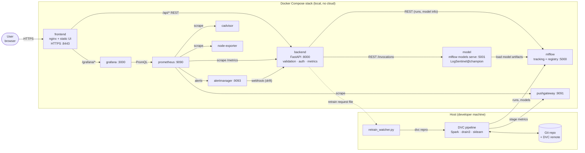
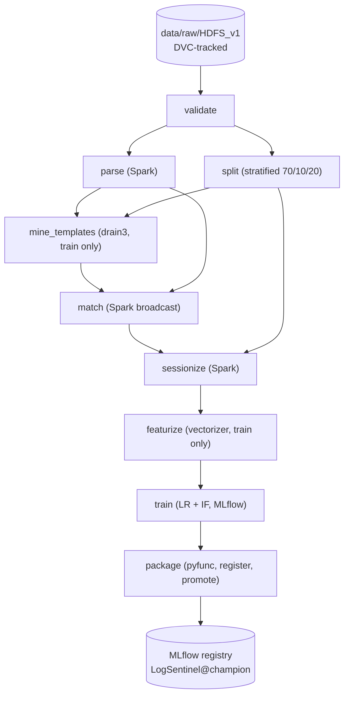
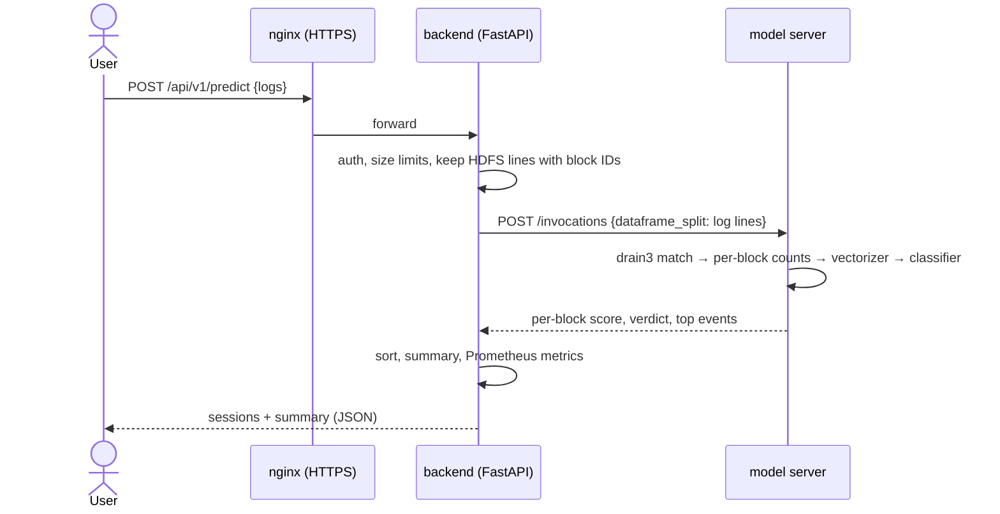

# LogSentinel – Architecture

GitHub renders the Mermaid diagrams below. To export a PNG for slides, paste a diagram into
https://mermaid.live and download it (or take a screenshot of the GitHub page).

## 1. System architecture (runtime)

| Block | Responsibility |
|---|---|
| **frontend (nginx)** | Serves the static UI over HTTPS, forwards `/api/*` to the backend and `/grafana/*` to Grafana. The UI only knows the backend through the configurable `API_BASE_URL`. |
| **backend (FastAPI)** | Input validation and limits, API-key auth, calls the model server, builds the response, pipeline console data (DVC stages, run history, errors, benchmark), feedback, retraining queue, Prometheus metrics. |
| **model (MLflow serve)** | Serves the registered pyfunc model `LogSentinel@champion`: raw lines → drain3 match → per-block counts → vectorizer → classifier → score + explanation. |
| **mlflow** | Experiment tracking (params, metrics, artifacts) and model registry (versions, `champion`/`challenger` aliases). Data in `./mlflow_data`. |
| **prometheus / pushgateway / alertmanager** | Metrics collection (pull from services, push from batch pipeline), alert rules, alert routing (drift → retraining webhook). |
| **grafana** | Near-real-time dashboards (5 s refresh), provisioned from files. |
| **cadvisor / node-exporter** | Per-container and host resource metrics, so every component is monitored (containers labelled by short Docker ID – Docker 29's containerd image store hides names from cAdvisor). |
| **DVC pipeline (host)** | validate → parse → split → mine_templates → match → sessionize → featurize → train → package; Spark for heavy stages. |
| **retrain_watcher (host)** | Turns retraining requests into `dvc repro` runs and restarts the model service. |

## 2. ML pipeline (DVC DAG)

## 3. Request flow (analyse logs)

