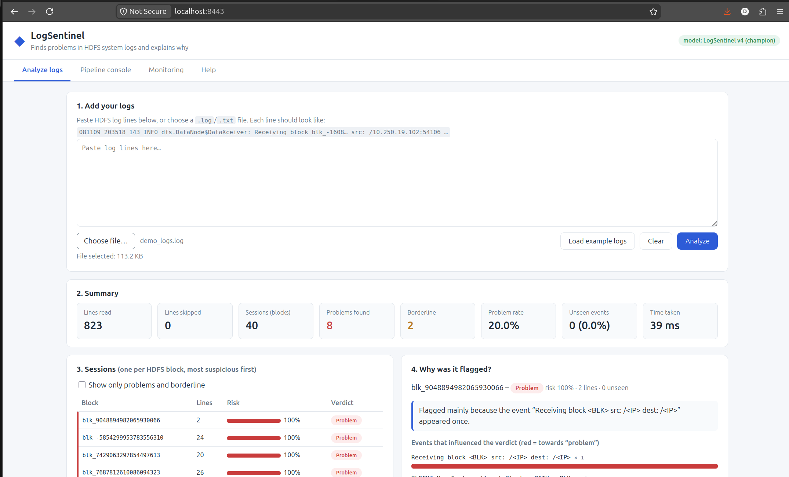
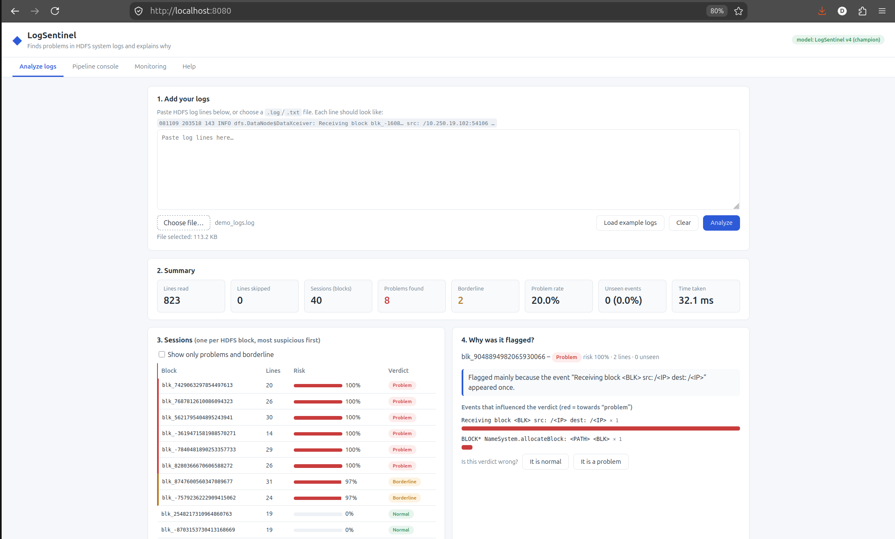
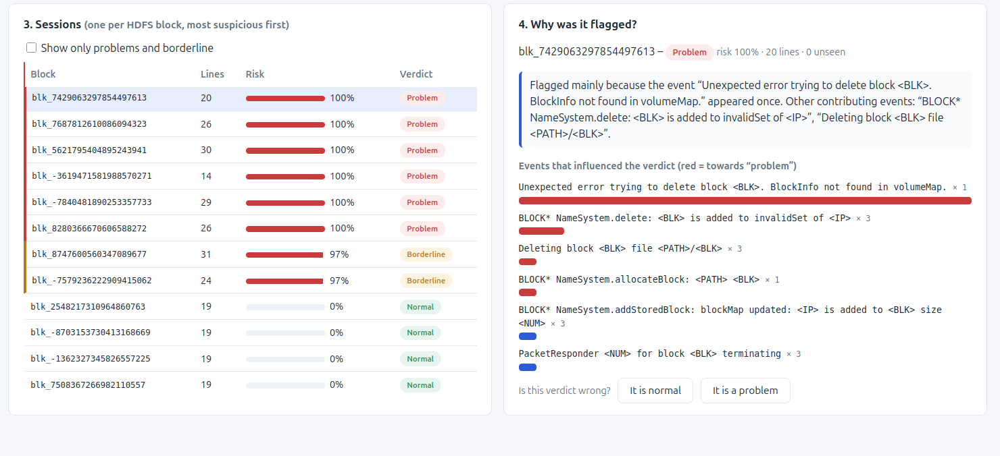
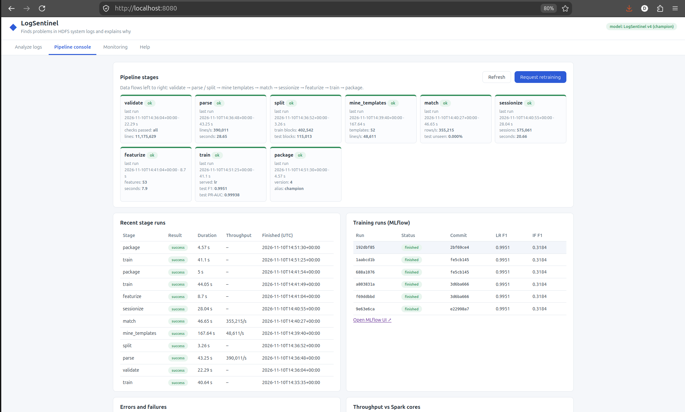
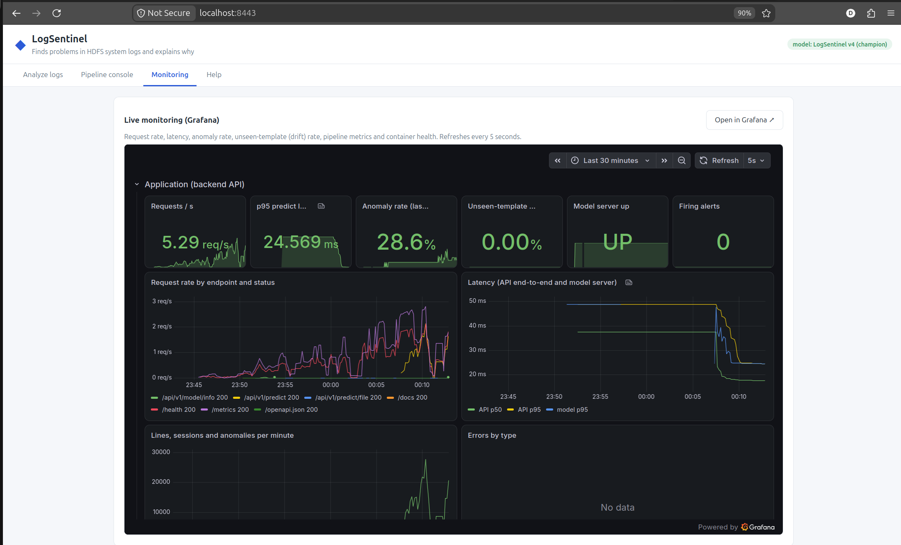

# LogSentinel – User Manual

*For anyone who needs to check system logs for problems. No technical knowledge needed.*

## What LogSentinel does

Large storage systems (here: Hadoop HDFS) write millions of log lines. LogSentinel reads those lines,
groups them by the piece of data they are about (a **block**), and tells you which blocks look like
they had a **problem** — and **why**, in plain words.

## Opening the application

1. Open your web browser and go to **https://localhost:8443**.
2. The first time, the browser warns that the connection is "not private". This is expected (the
   application uses its own security certificate). Click **Advanced → Proceed to localhost**.
3. At the top right you should see a green label such as *model: LogSentinel v1 (champion)*.
   If it is red, the system is still starting — wait a minute and refresh the page.

## Checking logs for problems

1. Go to the **Analyze logs** tab.
2. Add your logs in **one** of two ways:
   * paste log lines into the large text box, **or**
   * click **Choose file…** and pick a `.log` or `.txt` file (maximum 5 MB).
   Want to try it first? Click **Load example logs**.
3. Click **Analyze**. The button shows *Analyzing…* while it works (usually under a few seconds).

### Reading the results

* **Summary** – how many lines were read, how many were skipped (not log lines), how many blocks
  (sessions) were found and how many have problems.
* **Sessions** – one row per block, most suspicious first.
  * a **red** edge and a **Problem** label mean the block probably had a failure;
  * an **orange** edge and a **Borderline** label mean it is just below the problem line
    (risk 50% or more) – worth a quick look;
  * the **Risk** bar shows how sure the system is (green = low, orange = medium, red = high).
  * Tick **Show only problems** to hide normal blocks.
* **Why was it flagged?** – click any row. You get a sentence such as
  *"Flagged mainly because the event 'Exception in receiveBlock…' appeared once."* and a list of the
  log events that influenced the decision (red bars push towards "problem").

### Telling the system it was wrong

Under the explanation, click **It is normal** or **It is a problem** if you disagree. Your feedback
is saved and used when the model is retrained.

## Pipeline console (for administrators)

The **Pipeline console** tab shows the data pipeline that built the model:

* **Pipeline stages** – each step (validate, parse, …, package) with its status (green = OK,
  red = failed, grey = never run) and key numbers.
* **Recent stage runs** and **Training runs (MLflow)** – history of runs.
* **Errors and failures** – anything that went wrong recently.
* **Throughput vs Spark cores** – how fast the pipeline processes logs.
* **Request retraining** – asks the system to retrain the model.

## Monitoring

The **Monitoring** tab shows live charts: how many requests are coming in, how fast the system
answers, how many problems are being found, and whether new, never-seen log messages are appearing
(a sign the system has changed and the model may need retraining).

## Messages you might see

| Message | What it means | What to do |
|---|---|---|
| "Paste some log lines or choose a file first." | Nothing to analyse | Add logs |
| "None of the lines look like HDFS log lines…" | The text is not in the expected format | Check that lines look like the example shown |
| "N line(s) were skipped…" | Some lines were not log lines | Usually fine – headers or blank lines are ignored |
| "Too many lines" / "File too large" | Input above 50,000 lines / 5 MB | Split the file into smaller parts |
| "The anomaly model is not available right now." | The model service is starting or stopped | Wait a minute and retry; ask the administrator |
| "Cannot reach the LogSentinel server." | The application is not running | Ask the administrator to start it |

## Glossary

* **Block** – a piece of a file stored in HDFS.
* **Session** – all log lines about one block.
* **Problem / anomaly** – a block whose events look unlike healthy blocks.
* **Borderline** – almost a problem; the system is not sure enough to call it one.
* **Complete logs** – LogSentinel judges a block by its whole history. If you paste only the first few
  seconds of a log, most blocks look unfinished and may be flagged. Paste complete logs where possible.
* **Risk** – how confident the system is that a block has a problem.
* **Unseen event** – a log message type the system has never seen before.
